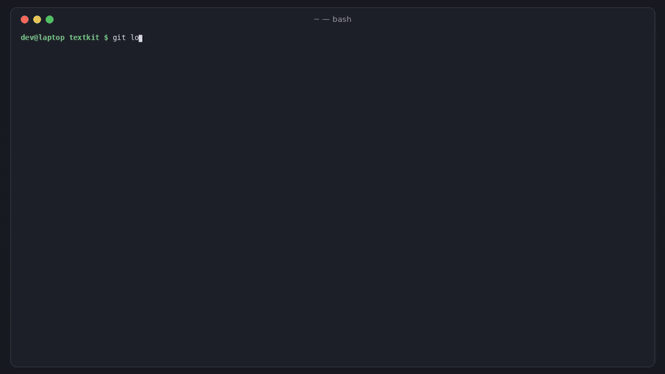

# benchmine

[](https://github.com/hamarshehmhmd/benchmine/actions/workflows/ci.yml)
[](LICENSE)


**Is the new coding model better on *your* code? Did the one you use quietly get worse?**

Every week brings a new coding model or harness, and a thread asking whether the old one got worse: ["Is Opus 5.5 nerfed? Thinking patterns changed on November 3"](https://news.ycombinator.com/item?id=50422069) (786 points), [Livenerf](https://news.ycombinator.com/item?id=49901736) (926 points). Those threads end in vibes versus vibes, because nobody has a baseline on their own work. Public leaderboards test someone else's tasks, and [their scores don't always hold up on re-check](https://news.ycombinator.com/item?id=50406222). The top comments keep asking for the same thing: *"we need to move to a world where it's easy to build and maintain our own benchmarks based off our own code base."*

`benchmine` builds that benchmark from your git history. Every past change that touched code **and** tests becomes a task: the parent commit is the starting tree, the commit / PR message is the prompt, and the change's own tests are the hidden grader. Run any agent (Claude Code, Codex, Gemini CLI, Cursor CLI, Aider, OpenCode or your own command) on the tasks, get pass rate with confidence intervals, time, cost and diff size, and re-run later to see whether a model update made things statistically worse.



```sh
curl -fsSL https://raw.githubusercontent.com/hamarshehmhmd/benchmine/main/install.sh | sh
```

(or `pipx install git+https://github.com/hamarshehmhmd/benchmine` / `uv tool install git+https://github.com/hamarshehmhmd/benchmine`. No dependencies, Python 3.9+, needs `git`. Linux and macOS.)

## How it works

```
benchmine mine      walk first-parent history -> tasks that change code + tests
                    validate each: hidden tests FAIL on the parent, PASS with the real change
benchmine run       for each task: clean copy of the parent tree (no .git history to peek at)
                    -> run the agent with the prompt -> put the hidden tests back -> run them
benchmine report    pass rate + 95% Wilson interval, median time, cost, $/pass, diff size vs the real change
benchmine compare   pair two runs task by task; exact sign test; exit 3 on a significant drop
```

- **Tasks come from your work**, so they test the code, conventions and dependencies you actually have. Merge commits use the PR title plus the branch's commit messages; `--gh` uses the PR title and body from GitHub instead.
- **Every task is validated.** Commits whose tests already pass before the change, or still fail after it, are dropped. Docs-only, test-only, version-bump and huge changes are skipped (`-v` shows why).
- **No peeking.** The agent gets an exported tree with a fresh one-commit repo, so `git log` can't show it the answer. Hidden test files are written back right before grading, so an agent that edits or deletes them gains nothing (and the edit is counted in `edited tests`).
- **Two built-in sanity agents.** `oracle` applies the real change and must score 100%; `noop` changes nothing and must score 0%. If they don't, your test command or task set needs work.
- **Statistics that tell you when there's no signal.** Agents are noisy and task sets are small. `compare` reports the paired delta with a bootstrap interval and a one-sided exact sign test (McNemar's exact test when each task ran once) and only calls it a `REGRESSION` below `--alpha` (default 0.05). You need at least 5 tasks moving the same way before anything can be significant, and it says so.

## Usage

```sh
cd your-repo
benchmine init                      # detects the test command; edit .benchmine/config.json if needed
benchmine mine -v                   # -> .benchmine/tasks.json
benchmine run --agent oracle -j 4   # must be 100%
benchmine run --agent noop -j 4     # must be 0%

benchmine run --agent claude-code --model opus --repeat 3 -j 4
benchmine run --agent codex --model gpt-6-astra --repeat 3 -j 4
benchmine run --agent my-agent --cmd 'my-agent --prompt-file {prompt_file}'
benchmine report                    # or --format md / json

# a month later, same tasks:
benchmine run --agent claude-code --model opus --label opus-dec --repeat 3 -j 4
benchmine compare latest:claude-code@opus latest:opus-dec   # exit 3 on a real drop
```

Run `benchmine run --agent codex --dry-run` to see the exact prompt, agent command and test command for the first task.

### Test command

`init`/`mine` guess it: `python -m pytest -q {tests}` (pyproject/setup.py), `go test {test_pkgs}`, `npx vitest run {tests}`, `npx jest {tests}`, `npm test`, `node --test {tests}`, `cargo test`, `bundle exec rspec {tests}`, `mvn test`, `./gradlew test`, `make test`. Override with `--test-cmd`. Placeholders: `{tests}` (the task's test files), `{test_dirs}`, `{test_pkgs}` (Go packages). If the tree needs dependencies, set `setup_cmd` (e.g. `npm ci`, `pip install -e .`); it runs in every fresh tree before the agent.

### Agents

| name | command template |
|---|---|
| `oracle` / `noop` | built in |
| `claude-code` | `claude -p {prompt} --output-format json --permission-mode acceptEdits --model {model}` (cost read from `total_cost_usd`) |
| `codex` | `codex exec --full-auto --skip-git-repo-check -m {model} - < {prompt_file}` |
| `gemini` | `gemini --yolo -m {model} -p {prompt}` |
| `cursor` | `cursor-agent -p --force --output-format text --model {model} {prompt}` |
| `aider` | `aider --yes-always --no-auto-commits --no-gitignore --no-check-update --model {model} --message-file {prompt_file}` (cost parsed from output) |
| `opencode` | `opencode run -m {model} {prompt}` |
| anything | `--cmd '...'` with `{prompt}`, `{prompt_file}`, `{model}`, `{task_id}`, `{workdir}`; env `BENCHMINE_PROMPT_FILE`, `BENCHMINE_COST_FILE` (write a USD number there to report cost) |

The presets follow each tool's documented headless mode; CLIs change flags, so check `benchmine agents` and `--dry-run` against your installed version.

### Output

Everything is local files under `.benchmine/` (`tasks.json`, `runs/<run-id>.json`, plus each attempt's agent patch and log in `runs/<run-id>/`). Commit `tasks.json` and `config.json` to share the task set with your team; runs are git-ignored by default.

## Demo

[`demo.mp4`](https://github.com/hamarshehmhmd/benchmine/releases/tag/v0.1.0) (2.5 min, narrated) on the v0.1.0 release. It runs on a generated demo repo (`python examples/make_demo_repo.py /tmp/textkit`) and on the real [more-itertools](https://github.com/more-itertools/more-itertools) history, where the last 60 commits give 21 validated tasks (oracle 21/21, noop 0/21; this is also a CI job).

**The "big-model" / "small-model" agents in the demo are a scripted stand-in (`examples/agents/standin.py`), not AI models**, and their costs are made up. They exist so the demo and CI are reproducible without paid accounts.

## Limits

- **Not a security sandbox.** Agents run as you, in a temp directory. Run benchmine inside a container or VM if you don't trust the agent with your machine.
- Prompts are only as good as your commit and PR messages. Thin messages ("fix bug") make unfair tasks; `--gh` helps, and short messages are skipped.
- Tasks whose tests need network, services or secrets will fail validation and be dropped, or need a `setup_cmd`.
- Hidden tests check behaviour the original author tested. An agent can pass with a different, worse design, or fail with a better one that changes an API the tests rely on. `diff vs ref` helps spot outliers.
- Your history may be in the model's training data if the repo is public. Prefer recent commits (`--since`) and private repos for model choice.
- Windows is untested.

## License

GNU Affero General Public License v3.0 or later (`AGPL-3.0-or-later`), see [LICENSE](LICENSE). Commercial licenses without the AGPL obligations are available from the author, Mohammad Hamarsheh ([@hamarshehmhmd](https://github.com/hamarshehmhmd)).
